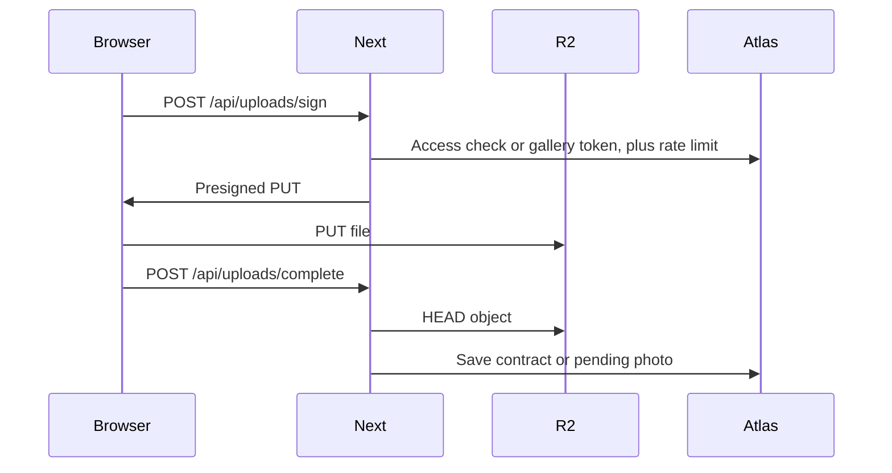

# Make My Marriage — API Design

Version 1. Product rules are in [make-my-marriage.md](make-my-marriage.md). Routes and stack are in [system-design.md](system-design.md). Fields are in [database-design.md](database-design.md).

The app is one Next.js monolith. Most operations are Server Actions called from forms. A Route Handler exists only when the browser needs a real HTTP response: a presigned upload, a QR image, or a Google Places search. There is no separate REST service.

## Conventions

- Authenticated actions take `weddingId` and call `requireWeddingAccess` before any read or write.
- Public actions take a `slug`, a guest `token`, or a `galleryToken`. They never trust a wedding id sent by the browser.
- Zod parses every input. Invalid input returns `VALIDATION` and does not touch the database.
- Dates in requests and responses are `YYYY-MM-DD`. Times are `HH:mm`. Money is an integer number of rupees.
- Lists return every row for that wedding. A single wedding is hundreds of guests, not millions, so version one has no paging.
- Successful actions return the saved object, or `{ ok: true }` when there is nothing to show.
- Failures return `{ error: { code, message } }`.

| Code              | When                                                                                                              |
| ----------------- | ----------------------------------------------------------------------------------------------------------------- |
| `UNAUTHENTICATED` | No session on a workspace action                                                                                  |
| `FORBIDDEN`       | Signed in, but this role cannot do this                                                                           |
| `NOT_FOUND`       | Wedding, guest token, or gallery token does not match. Public misses use the same message so callers cannot probe |
| `VALIDATION`      | Zod rejected the body                                                                                             |
| `CONFLICT`        | Slug already taken, or a milestone payment raced                                                                  |
| `RATE_LIMITED`    | Phone lookup or upload signing exceeded the window                                                                |

Roles below are `planner`, `couple`, `family`, and `guest`. `planner` includes the wedding owner. `couple` can do every workspace action except delete the wedding and remove the planner.

## Auth

No wedding id. Session cookie after success.

- `signup` — public. Input: `name`, `email`, `password` of at least 8 characters, optional `businessName`. Creates a planner user and a session.
- `updateAccount` — session. Input: optional `name`, optional `businessName`, optional `password` of at least 8 characters. Updates the signed-in user.
- `login` — public. Input: `email`, `password`. Returns a session. Unknown email and wrong password use the same message.
- `logout` — session. Clears the cookie.
- `requestPasswordReset` — public. Input: `email`. Always returns `{ ok: true }`. When the account exists, Resend sends a single-use link.
- `resetPassword` — public. Input: `token`, `password`. Consumes the token.
- `acceptInvite` — public. Input: `token`, and `password` when the email is new. Creates the user if needed, marks the member active, and opens a session on that wedding.

Invite and reset tokens are hashed in the database, expire in 7 days, and work once.

## Weddings

- `listWeddings` — session. Returns two groups: weddings the user owns, and weddings where they are an active member. Each card includes couple names, city, primary date, days remaining, RSVP progress, open tasks, and budget spent versus planned. A user who owns nothing and belongs to one wedding is sent straight into that wedding.
- `createWedding` — planner. Input: `brideName`, `groomName`, `city`, `primaryDate`, `template` (`indian-multi-event` or `blank`). Seeds events and the checklist from the product requirements when the template is Indian multi-event. Generates `galleryToken` and a slug from the couple names. If the slug is taken, append `-2`, then `-3`.
- `getWedding` — planner, couple, family. Returns the wedding, the caller’s role, and embedded events. Family receives events and the run sheet. Internal notes stay off any public call.
- `updateWedding` — planner, couple. Patch of names, title, city, primary date, timezone, and currency. Changing `primaryDate` does not move existing events.
- `deleteWedding` — planner. Deletes the wedding, its child rows, and its R2 objects.
- `getDashboard` — planner, couple, family. Returns days remaining, next event, open and overdue tasks, RSVP counts, and budget by side. Pending photo count is included for planner and couple only. Events are ordered by date, then start time.

## Events and run sheet

Planner and couple write. Family reads.

- `addEvent` — input: `name`, `date`, `startTime`, optional `endTime`, venue, address, map link, dress code, notes, `isPublic`.
- `updateEvent` — same fields, by `eventId`.
- `deleteEvent` — removes the embedded event, unsets `eventId` on tasks, and pulls that id from guest invites and RSVPs.
- `addRunSheetItem`, `updateRunSheetItem`, `deleteRunSheetItem` — by `eventId` and item id. Fields: `time`, `title`, `ownerName`, `notes`, `order`.
- `reorderRunSheet` — input: `eventId` and the item ids in order.

The run sheet is never returned by public wedding reads.

## Tasks

- `listTasks` — planner, couple, family. Filters: `status`, `assigneeId`, `eventId`, `overdue`.
- `createTask` — planner, couple, family. Input: `title`, optional `notes`, `status`, `dueDate`, `assigneeId`, `eventId`, `phase`.
- `updateTask` — planner, couple, family. Same fields, including moving a task to `done`.
- `deleteTask` — planner, couple, family.

`assigneeId` must be the planner or an active member of this wedding. `eventId` must be an event on this wedding.

## Vendors, milestones, and budget

Planner and couple write. Family has no vendor access. Family can read budget lines and expenses.

- `listVendors`, `createVendor`, `updateVendor`, `deleteVendor`.
- Vendor input: `name`, `category`, `contactName`, `phone`, `email`, `quote`, `status`, `side`, `notes`, optional `googlePlaceId`, `address`, `mapsUrl`.
- `deleteVendor` unsets `vendorId` on budget lines and expenses and deletes private contract files. Past expenses stay.
- `addMilestone` — `label`, `amount`, optional `dueDate`.
- `updateMilestone` — same fields while `unpaid`.
- `setMilestonePaid` — one transaction: mark the milestone paid and insert one linked expense if `expenseId` is empty. Returns the expense.
- `setMilestoneUnpaid` — one transaction: mark unpaid and delete the linked expense.
- `listBudgetLines`, `createBudgetLine`, `updateBudgetLine`, `deleteBudgetLine`. Input: `category`, `side`, `plannedAmount`, `notes`, optional `vendorId`.
- `listExpenses`, `createExpense`, `updateExpense`, `deleteExpense`. Input: `amount`, `date`, `side`, `category`, `note`, optional `vendorId`. A manual expense has no `milestoneId`. Deleting an expense that is linked to a milestone is refused. Use `setMilestoneUnpaid` instead.

## Places and contracts

HTTP, because the browser needs a search response and a file URL.

- `GET /api/places/search?q=` — planner, couple, and a `weddingId` query param. Returns a short list of `{ googlePlaceId, name, address, phone }`. The Google key stays on the server. Empty `q` is `VALIDATION`.
- `POST /api/uploads/sign` with `purpose: "contract"` — planner, couple. Body: `weddingId`, `vendorId`, `contentType`, `size`, `filename`. Returns `{ uploadUrl, key, fileId }`. PDF or image, max 10 MB, URL expires in 5 minutes.
- `POST /api/uploads/complete` with `purpose: "contract"` — planner, couple. Body: `weddingId`, `vendorId`, `key`, `fileId`. Server HEADs the object, then appends the contract on the vendor.
- `getContractDownloadUrl` — planner, couple. Returns a signed GET that expires in a few minutes.
- `deleteContract` — planner, couple. Input: `vendorId`, `fileId`. Deletes the private object and removes it from the vendor.

## Guests and invites

- `listGuests` — planner, couple, family. Filters: `side`, `eventId`, `replied`.
- `createGuest` — planner, couple, family. Household fields from the database design. Server generates `token` and a pending RSVP for each invited event.
- `pasteGuests` — planner, couple, family. Input: up to 200 lines of `Name, phone`. Each row is `side: bride`, `partySize: 1`, no events. Returns the created count and any skipped blank lines. `listGuests` includes `rsvpUrl` for planner, couple, and family.
- `updateGuest` — planner, couple, family. Can change household fields and `invitedEventIds`. Adding an event adds a `pending` RSVP. Removing an event drops that RSVP.
- `deleteGuest` — planner, couple, family.
- `previewInvite` — planner, couple. Input: `guestId`, `kind` (`invite` or `reminder`). Returns `{ text, rsvpUrl, whatsAppUrl }`. A 10-digit phone becomes a `wa.me` link with country code 91. Otherwise `whatsAppUrl` is null and the caller copies `text`.
- Family can copy `rsvpUrl` for a guest. Family cannot edit the message templates.
- `updateInviteTemplates` — planner, couple. Input: `invite`, `reminder`.

The server does not send WhatsApp messages.

## People

- `listMembers` — planner, couple, family. Returns name, email, role, and invite status. Does not return token hashes.
- `inviteMember` — planner, couple. Input: `name`, `email`, `role` (`couple` or `family`). More than one couple member is allowed. Creates a pending member, returns a copyable invite URL, and sends it with Resend. An email already pending or active on this wedding is `CONFLICT`.
- `revokeInvite` — planner, couple. Pending invites only.
- `removeMember` — planner, or couple when the target is not the planner. Unsets that user’s task assignments, then deletes the member row. The user account stays.

## Website and live

Planner and couple.

- `updateWebsite` — `template` (`editorial`, `festive`, `minimal`), `story`, `coverPublicUrl`, and `isPublic` on events.
- `updateSlug` — new slug. `CONFLICT` if another wedding owns it. The previous slug stops resolving.
- `publishWedding` — sets `published` true.
- `unpublishWedding` — sets `published` false. Token RSVP and the private gallery keep working.
- `updateLive` — `youtubeUrl`, `visible`. A non-YouTube URL is `VALIDATION`. Empty URL forces `visible` false.

Cover upload uses the same sign and complete routes with `purpose: "cover"`. The object is stored in the public bucket because the page has to show it. Returns `coverPublicUrl`.

## Gallery and QR

- `listPhotos` — planner, couple. Filter `status`: `pending` or `approved`. Family may call this only with `status: approved`.
- `approvePhoto` — planner, couple. Copies the object to the public bucket, sets `publicUrl`, then deletes the private object. If the copy fails, the photo stays `pending`.
- `rejectPhoto` — planner, couple. Deletes the private object and the photo row.
- `GET /api/weddings/{weddingId}/qr` — planner, couple. Returns `image/png`. The code encodes `{APP_URL}/g/{galleryToken}`.

Guest upload is HTTP:

- `POST /api/uploads/sign` with `purpose: "photo"`. No session. Body: `galleryToken`, `contentType`, `size`. Rate limited. Returns `{ uploadUrl, key, photoId }`. JPEG, PNG, or WebP, max 10 MB.
- `POST /api/uploads/complete` with `purpose: "photo"`. Body: `galleryToken`, `photoId`, `key`, `uploaderName`, optional `note`. HEADs the object and inserts the photo as `pending`. Repeating the same `key` returns the existing row.

A guest may complete at most 10 photos per upload action.

## Public reads and RSVP

These run on the server for the public pages. They are not workspace actions.

- `getPublicWedding` — input: `slug`. Unpublished weddings return only `{ published: false }`. Published weddings return names, date, city, story, cover, public events, live embed when visible, and approved photo URLs. No phones, notes, run sheet, or budget.
- `getRsvp` — input: `slug`, `token`. Returns the household name, invited events, current RSVP, `partySize`, meal, and note. Works when the site is unpublished. Unknown token is `NOT_FOUND`.
- `submitRsvp` — input: `slug`, `token`, per-event `yes` or `no`, `attendingCount`, `meal`, `responseNote`. `attendingCount` cannot exceed `partySize`. Saves and sets `respondedAt`.
- `lookupInvite` — input: `slug`, `phone`. Published weddings only. Match on the last 10 digits. One match returns the token path. Zero or several matches return the same “use your WhatsApp link” message. Limit: 10 attempts per 15 minutes for that slug and IP.
- Photo `uploads/sign` is limited to 30 requests an hour for that gallery token and IP.
- `getPrivateGallery` — input: `galleryToken`. Returns approved photos and whether upload is open. Works before publish. Unknown token is `NOT_FOUND`. Pending photos are omitted.

## Upload sequence

## Multi-tenant rule

Every workspace action resolves the caller to one role on one wedding, then queries with that `weddingId`. `listWeddings` is the only list that gathers more than one wedding, and it returns only weddings the user owns or has joined. A planner never receives another planner’s ids. A member never receives a wedding they have not joined.

## Summary

This document covers the version-one API:

- Server Actions for workspace changes, and Route Handlers for uploads, the QR image, and Google Places.
- Error codes, dates, money, and the role required on each call.
- Auth, including account update and password reset storage, weddings, events, tasks, vendors, milestones, budget, guests, invites, members, website, and YouTube live.
- Public RSVP, phone lookup, the private gallery, photo approval, and the QR code.
- The rule that keeps one planner’s weddings out of another planner’s responses.
