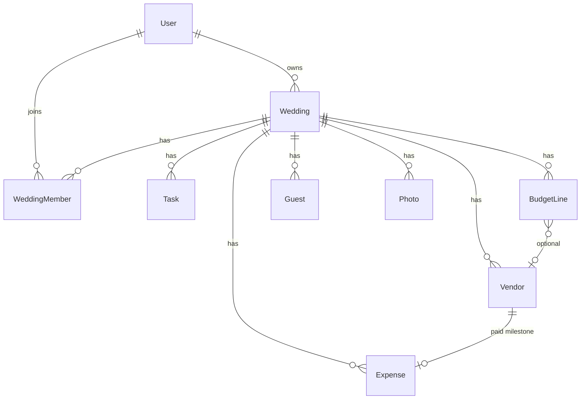

# Make My Marriage — Database Design

Version 1 schema for MongoDB Atlas, accessed with Mongoose. Product rules are in [make-my-marriage.md](make-my-marriage.md). System shape is in [system-design.md](system-design.md). This document is the field-level source of truth.

## Decisions

- One cluster, two databases: `makemymarriage-dev` and `makemymarriage-prod`. The database name comes from `MONGODB_DB`.
- Region `ap-south-1`.
- Identifiers are MongoDB `ObjectId` unless a field is a public token or a slug.
- Calendar dates are strings `YYYY-MM-DD`. Clock times are strings `HH:mm` in the wedding time zone (`Asia/Kolkata`). This keeps “14 October” from shifting a day when the server is in UTC.
- Instants (`createdAt`, `updatedAt`, `respondedAt`, `reviewedAt`, `expiresAt`, `windowStart`) are UTC `Date` values.
- Money is an integer number of rupees. Version one does not store paise.
- There are no foreign-key constraints. The application deletes or unsets related rows. Every query is scoped by `weddingId` or `ownerId` after `requireWeddingAccess`.
- Zod checks input at the route. Mongoose checks the shape before write.

## What is embedded

Events and run-sheet rows live inside the wedding document. A wedding has a handful of events, and the public page always loads them with the wedding.

Guests, tasks, vendors, budget lines, expenses, photos, and members are their own collections. Those lists are filtered and updated on their own. Embedding them would push the wedding document toward the 16 MB limit.

`Event` and `RunSheetItem` are subdocuments of `Wedding`, so they do not appear as collections.

## users

Planner accounts, and couple or family accounts created from an invite.

| Field          | Type     | Rules                                                 |
| -------------- | -------- | ----------------------------------------------------- |
| `_id`          | ObjectId | Primary key                                           |
| `name`         | string   | Required                                              |
| `email`        | string   | Required, unique, stored lowercase                    |
| `passwordHash` | string   | Required. bcryptjs hash. Never returned to the client |
| `businessName` | string   | Optional. Planner signup only                         |
| `createdAt`    | Date     | Required                                              |
| `updatedAt`    | Date     | Required                                              |

Index: unique `email`.

## passwordResets

One row per unused reset link. Invite tokens stay on `weddingMembers` and are not stored here.

| Field       | Type     | Rules                             |
| ----------- | -------- | --------------------------------- |
| `_id`       | ObjectId | Primary key                       |
| `email`     | string   | Required, lowercase               |
| `tokenHash` | string   | Required, unique                  |
| `expiresAt` | Date     | Required. 7 days from the request |
| `createdAt` | Date     | Required                          |

Indexes: unique `tokenHash`. TTL on `expiresAt`. Requesting a new reset deletes older unused rows for that email. The raw token is only in the Resend link.

## weddings

One document per client wedding. `ownerId` is the planner.

| Field          | Type     | Rules                                                                         |
| -------------- | -------- | ----------------------------------------------------------------------------- |
| `_id`          | ObjectId | Primary key                                                                   |
| `ownerId`      | ObjectId | Required. References `users`                                                  |
| `brideName`    | string   | Required                                                                      |
| `groomName`    | string   | Required                                                                      |
| `title`        | string   | Required. Default `"{brideName} & {groomName}"`                               |
| `city`         | string   | Required                                                                      |
| `primaryDate`  | string   | Required. `YYYY-MM-DD`                                                        |
| `timezone`     | string   | Required. Default `Asia/Kolkata`                                              |
| `currency`     | string   | Required. Default `INR`                                                       |
| `template`     | string   | Required. `indian-multi-event` or `blank`                                     |
| `slug`         | string   | Required, unique. Lowercase letters, numbers, and single hyphens              |
| `galleryToken` | string   | Required, unique. 32 bytes, base64url. Private gallery is `/g/{galleryToken}` |
| `published`    | boolean  | Required. Default `false`                                                     |
| `website`      | object   | See below                                                                     |
| `messages`     | object   | `invite` and `reminder` strings                                               |
| `live`         | object   | `youtubeUrl` string, `visible` boolean. Default `visible: false`              |
| `events`       | array    | Embedded events. See below                                                    |
| `createdAt`    | Date     | Required                                                                      |
| `updatedAt`    | Date     | Required                                                                      |

`website`:

| Field            | Type   | Rules                                                     |
| ---------------- | ------ | --------------------------------------------------------- |
| `template`       | string | `editorial`, `festive`, or `minimal`. Default `editorial` |
| `story`          | string | Optional                                                  |
| `coverPublicUrl` | string | Optional. Public R2 URL                                   |

Each `events[]` item:

| Field       | Type     | Rules                                        |
| ----------- | -------- | -------------------------------------------- |
| `_id`       | ObjectId | Stable id used by tasks and guest RSVPs      |
| `name`      | string   | Required                                     |
| `date`      | string   | Required. `YYYY-MM-DD`                       |
| `startTime` | string   | Required. `HH:mm`                            |
| `endTime`   | string   | Optional. `HH:mm`                            |
| `venueName` | string   | Optional                                     |
| `address`   | string   | Optional                                     |
| `mapLink`   | string   | Optional                                     |
| `dressCode` | string   | Optional                                     |
| `notes`     | string   | Optional. Internal. Never on the public page |
| `isPublic`  | boolean  | Required. Default `true`                     |
| `runSheet`  | array    | Internal. Ordered by `order`                 |

Each `runSheet[]` item:

| Field       | Type     | Rules                              |
| ----------- | -------- | ---------------------------------- |
| `_id`       | ObjectId |                                    |
| `time`      | string   | Optional. `HH:mm`                  |
| `title`     | string   | Required                           |
| `ownerName` | string   | Optional. Member name or free text |
| `notes`     | string   | Optional                           |
| `order`     | number   | Required. Integer, starting at 0   |

Indexes:

- Unique `slug`
- Unique `galleryToken`
- `ownerId` + `primaryDate`

## weddingMembers

Couple and family invites. The planner is `weddings.ownerId` and does not get a member row.

| Field          | Type     | Rules                                                     |
| -------------- | -------- | --------------------------------------------------------- |
| `_id`          | ObjectId | Primary key                                               |
| `weddingId`    | ObjectId | Required                                                  |
| `userId`       | ObjectId | Empty until the invite is accepted                        |
| `role`         | string   | Required. `couple` or `family`                            |
| `name`         | string   | Required                                                  |
| `email`        | string   | Required, lowercase                                       |
| `inviteStatus` | string   | Required. `pending` or `active`                           |
| `tokenHash`    | string   | Hash of the single-use invite token. Cleared after accept |
| `expiresAt`    | Date     | Required while pending. 7 days from invite                |
| `createdAt`    | Date     | Required                                                  |
| `updatedAt`    | Date     | Required                                                  |

Indexes:

- Unique `{ weddingId, email }`
- `userId`

## tasks

| Field        | Type     | Rules                                                      |
| ------------ | -------- | ---------------------------------------------------------- |
| `_id`        | ObjectId | Primary key                                                |
| `weddingId`  | ObjectId | Required                                                   |
| `title`      | string   | Required                                                   |
| `notes`      | string   | Optional                                                   |
| `status`     | string   | Required. `todo`, `in_progress`, or `done`. Default `todo` |
| `dueDate`    | string   | Optional. `YYYY-MM-DD`                                     |
| `assigneeId` | ObjectId | Optional. A `users._id` of the planner or an active member |
| `eventId`    | ObjectId | Optional. An `events._id` on the same wedding              |
| `phase`      | string   | Optional. `early`, `one_month`, `one_week`, or `day_of`    |
| `createdAt`  | Date     | Required                                                   |
| `updatedAt`  | Date     | Required                                                   |

Indexes:

- `{ weddingId, status, dueDate }`
- `{ weddingId, assigneeId }`

When a member is removed, tasks with that `assigneeId` have it unset. When an event is deleted, tasks keep their row and `eventId` is unset.

## vendors

| Field           | Type     | Rules                                                                                   |
| --------------- | -------- | --------------------------------------------------------------------------------------- |
| `_id`           | ObjectId | Primary key                                                                             |
| `weddingId`     | ObjectId | Required                                                                                |
| `name`          | string   | Required                                                                                |
| `category`      | string   | Required. One of the vendor categories in the PRD                                       |
| `contactName`   | string   | Optional                                                                                |
| `phone`         | string   | Optional. Digits, used as entered                                                       |
| `email`         | string   | Optional                                                                                |
| `quote`         | number   | Optional. Integer rupees. Minimum 0                                                     |
| `status`        | string   | Required. `enquiry`, `quoted`, `booked`, `completed`, or `cancelled`. Default `enquiry` |
| `side`          | string   | Required. `bride`, `groom`, or `shared`. Default `shared`                               |
| `notes`         | string   | Optional                                                                                |
| `googlePlaceId` | string   | Optional                                                                                |
| `address`       | string   | Optional. Filled from Places or typed                                                   |
| `mapsUrl`       | string   | Optional                                                                                |
| `contracts`     | array    | Private R2 files. See below                                                             |
| `milestones`    | array    | Payment schedule. See below                                                             |
| `createdAt`     | Date     | Required                                                                                |
| `updatedAt`     | Date     | Required                                                                                |

Vendor categories: `venue`, `catering`, `decor`, `photo_video`, `makeup_attire`, `music`, `priest_ritual`, `invitations`, `stay_travel`, `other`.

Each `contracts[]` item:

| Field         | Type     | Rules                           |
| ------------- | -------- | ------------------------------- |
| `_id`         | ObjectId |                                 |
| `key`         | string   | Required. Private R2 object key |
| `filename`    | string   | Required                        |
| `contentType` | string   | Required. PDF or image          |

Each `milestones[]` item:

| Field       | Type     | Rules                                          |
| ----------- | -------- | ---------------------------------------------- |
| `_id`       | ObjectId |                                                |
| `label`     | string   | Required. Example: Advance, Balance            |
| `amount`    | number   | Required. Integer rupees. Minimum 0            |
| `dueDate`   | string   | Optional. `YYYY-MM-DD`                         |
| `status`    | string   | Required. `unpaid` or `paid`. Default `unpaid` |
| `expenseId` | ObjectId | Set when paid. References `expenses`           |

Index: `weddingId`.

## budgetLines

The plan. This is not money already spent.

| Field           | Type     | Rules                                   |
| --------------- | -------- | --------------------------------------- |
| `_id`           | ObjectId | Primary key                             |
| `weddingId`     | ObjectId | Required                                |
| `category`      | string   | Required. Same category set as vendors  |
| `side`          | string   | Required. `bride`, `groom`, or `shared` |
| `plannedAmount` | number   | Required. Integer rupees. Minimum 0     |
| `notes`         | string   | Optional                                |
| `vendorId`      | ObjectId | Optional                                |
| `createdAt`     | Date     | Required                                |
| `updatedAt`     | Date     | Required                                |

Index: `weddingId`.

## expenses

The actual money out. Dashboard “spent” is the sum of `amount` for that wedding, grouped by `side`.

| Field         | Type     | Rules                                                       |
| ------------- | -------- | ----------------------------------------------------------- |
| `_id`         | ObjectId | Primary key                                                 |
| `weddingId`   | ObjectId | Required                                                    |
| `amount`      | number   | Required. Integer rupees. Minimum 1                         |
| `date`        | string   | Required. `YYYY-MM-DD`                                      |
| `side`        | string   | Required. `bride`, `groom`, or `shared`                     |
| `category`    | string   | Required                                                    |
| `note`        | string   | Optional                                                    |
| `vendorId`    | ObjectId | Optional                                                    |
| `milestoneId` | ObjectId | Optional. Set when the expense was created from a milestone |
| `createdAt`   | Date     | Required                                                    |
| `updatedAt`   | Date     | Required                                                    |

Index: `weddingId`. Also `{ weddingId, milestoneId }` so a milestone cannot create two expenses.

Marking a milestone paid and inserting its expense is one multi-document transaction. Marking it unpaid deletes that expense in the same transaction. No other write in version one uses a transaction.

## guests

One document is one household.

| Field             | Type       | Rules                                                                     |
| ----------------- | ---------- | ------------------------------------------------------------------------- |
| `_id`             | ObjectId   | Primary key                                                               |
| `weddingId`       | ObjectId   | Required                                                                  |
| `name`            | string     | Required                                                                  |
| `phone`           | string     | Required. Stored as digits. Lookup uses the last 10 digits                |
| `email`           | string     | Optional                                                                  |
| `side`            | string     | Required. `bride` or `groom`                                              |
| `partySize`       | number     | Required. Integer. Minimum 1. Default 1                                   |
| `meal`            | string     | Required. `unset`, `veg`, `jain`, `non_veg`, or `mixed`. Default `unset`  |
| `needsStay`       | boolean    | Required. Default `false`                                                 |
| `stayNote`        | string     | Optional                                                                  |
| `internalNotes`   | string     | Optional. Never on the public page                                        |
| `token`           | string     | Required, unique. 32 bytes, base64url. RSVP path is `/w/{slug}/r/{token}` |
| `invitedEventIds` | ObjectId[] | Event ids on this wedding. May be empty                                   |
| `rsvps`           | array      | One entry per invited event                                               |
| `attendingCount`  | number     | Optional. Guest may lower it, never above `partySize`                     |
| `responseNote`    | string     | Optional. Message from the guest                                          |
| `respondedAt`     | Date       | Set when they save an RSVP                                                |
| `createdAt`       | Date       | Required                                                                  |
| `updatedAt`       | Date       | Required                                                                  |

Each `rsvps[]` item:

| Field     | Type     | Rules                                                  |
| --------- | -------- | ------------------------------------------------------ |
| `eventId` | ObjectId | Required                                               |
| `status`  | string   | Required. `pending`, `yes`, or `no`. Default `pending` |

Indexes:

- Unique `token`
- `{ weddingId, phone }`
- `weddingId`

Pasted rows are created with `side: bride`, `partySize: 1`, and `invitedEventIds: []`.

A household is replied when every invited event is `yes` or `no`. Attending headcount adds `attendingCount` (or `partySize` if they did not lower it) when at least one event is `yes`. All `no` adds zero.

Deleting an event pulls that id from `invitedEventIds` and from `rsvps`.

## photos

Metadata only. The bytes live in R2.

| Field          | Type     | Rules                                                             |
| -------------- | -------- | ----------------------------------------------------------------- |
| `_id`          | ObjectId | Primary key                                                       |
| `weddingId`    | ObjectId | Required                                                          |
| `uploaderName` | string   | Required                                                          |
| `note`         | string   | Optional                                                          |
| `status`       | string   | Required. `pending`, `approved`, or `rejected`. Default `pending` |
| `privateKey`   | string   | Required, unique. Private R2 key                                  |
| `publicUrl`    | string   | Set on approve                                                    |
| `contentType`  | string   | Required. `image/jpeg`, `image/png`, or `image/webp`              |
| `size`         | number   | Required. Bytes. Maximum 10 MB                                    |
| `reviewedAt`   | Date     | Set on approve or reject                                          |
| `reviewedBy`   | ObjectId | Planner or couple `users._id`                                     |
| `createdAt`    | Date     | Required                                                          |
| `updatedAt`    | Date     | Required                                                          |

Indexes:

- Unique `privateKey`
- `{ weddingId, status, createdAt }`

Reject deletes the R2 object and this document. Approve copies the object to the public bucket, sets `publicUrl` and `status`, then deletes the private object.

## rateLimits

Fixed-window counters for phone lookup and upload signing.

| Field         | Type     | Rules                                                                         |
| ------------- | -------- | ----------------------------------------------------------------------------- |
| `_id`         | ObjectId | Primary key                                                                   |
| `key`         | string   | Required, unique. Example: `rsvp:{slug}:{ip}` or `upload:{galleryToken}:{ip}` |
| `count`       | number   | Required. Incremented with `findOneAndUpdate` and upsert                      |
| `windowStart` | Date     | Required. TTL so old windows expire                                           |

Indexes:

- Unique `key`
- TTL on `windowStart`

## Delete rules

These run in the application, in this order:

- **Delete wedding.** Delete `weddingMembers`, `tasks`, `vendors`, `budgetLines`, `expenses`, `guests`, and `photos` for that `weddingId`, delete their R2 objects, then delete the wedding. Leave `users` and `passwordResets` in place.
- **Remove member.** Unset `tasks.assigneeId` where it matches that user. Delete the member row. Do not delete the user account.
- **Delete event.** Unset `tasks.eventId`. Pull the event id from every guest’s `invitedEventIds` and `rsvps`. Then remove the embedded event.
- **Delete vendor.** Unset `vendorId` on budget lines and expenses. Delete private contract objects. Leave past expenses in place so spent stays correct.

## Validation shared by Zod and Mongoose

- Slug matches `^[a-z0-9]+(?:-[a-z0-9]+)*$`.
- `galleryToken` and guest `token` are unguessable and unique.
- YouTube URL is `youtube.com/watch`, `youtu.be`, or `youtube.com/live`.
- Money fields are integers greater than or equal to 0, except `expenses.amount`, which is at least 1.
- `partySize` is an integer of at least 1.
- `attendingCount` is an integer from 1 through `partySize`.
- Photo `contentType` is jpeg, png, or webp. Contract `contentType` is a PDF or an image.
- Email is stored lowercase.
- Password is at least 8 characters before hashing.
- Phone lookup compares the last 10 digits.

## Summary

This document covers the version-one MongoDB schema:

- Shared cluster and two databases, `makemymarriage-dev` and `makemymarriage-prod`.
- Multi-tenant layout: every planner is a tenant through `weddings.ownerId`. Child rows carry `weddingId`. Couple and family are members of one wedding, not separate tenants.
- What is embedded (events and run sheet) and what is its own collection.
- Field types and indexes for `users`, `passwordResets`, `weddings`, `weddingMembers`, `tasks`, `vendors`, `budgetLines`, `expenses`, `guests`, `photos`, and `rateLimits`.
- Date, time, and money conventions.
- The milestone payment transaction.
- Delete rules and the checks shared by Zod and Mongoose.
