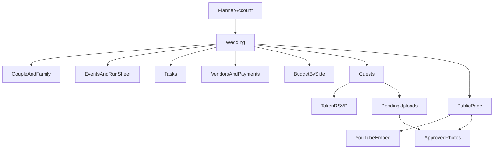

# Make My Marriage — Product Requirements

Version 1 PRD. This is the spec to build. Decisions below are locked unless you change them before implementation.

## 1. Problem

An Indian wedding is several events, two families, a vendor list, and a guest list that changes until the week of the wedding. A solo planner runs many of these at once. The work sits in WhatsApp chats, spreadsheets, and memory: who is coming to which function, which vendor is still owed money, and where the photos went.

## 2. Product

Make My Marriage is the planner’s workspace for every client wedding, and the phone page guests use to reply, watch, and send photos.

- One planner account holds many weddings.
- The couple and a few family members get a login on a single wedding.
- Guests do not create accounts. They use a private link.
- Version one covers planning, money, guests, invites, the public page, live viewing, and the photo gallery.

## 3. Goals

- A planner can create a wedding, seed it from a template, and invite the couple in one sitting.
- The planner can see, for every active wedding, what is due, who has replied, and how much money is left.
- A guest can RSVP for each event and upload photos from a phone without an account.
- The couple can approve photos and follow the plan without seeing the planner’s other clients.
- One planner’s weddings are never visible to another planner.

## 4. Users and permissions

- **Planner.** Signed up directly. Owns the wedding. Full access, including delete wedding and remove members.
- **Couple.** Invite only. Can manage the wedding, including vendors, budget, website, live settings, and photo approval. Cannot delete the wedding or remove the planner.
- **Family.** Invite only. Can create and edit tasks and guests, copy guest links, and view events, run sheet, budget, and approved photos. Cannot edit vendors, website, live settings, or the approval queue.
- **Guest.** No login. Can open the published page, submit their own RSVP, watch the live link, and upload photos.

Couple may invite family. Family cannot invite people. A person’s email can belong to a planner account and also be a member of someone else’s wedding; access is always per wedding.

## 5. Planner home

After login the planner sees only their weddings. Each card shows couple names, city, primary date, days remaining, RSVP progress (households replied / invited), open tasks, and budget spent versus planned.

Empty state offers two actions: start from the Indian wedding template, or start blank.

Home shows two groups when both exist: weddings this user owns, and weddings where they are an active member. A user who owns nothing and belongs to one wedding goes straight into that wedding. A user who owns nothing and belongs to several sees only those weddings.

## 6. Wedding setup

Required to create a wedding:

- Bride’s name, groom’s name
- City
- Primary wedding date
- Template: Indian multi-event, or blank

Display title defaults to “Bride & Groom”. Time zone defaults to Asia/Kolkata. Currency defaults to INR. The planner can edit these later. Changing the primary date does not move events that already exist.

The slug is generated from the couple names, lowercased, with words joined by hyphens. If that slug is taken, the server appends `-2`, then `-3`, and so on. Passwords are at least 8 characters.

### Indian multi-event template

On create, seed five events relative to the primary date. Times are `HH:mm`.

- Mehendi, two days before, 16:00
- Haldi, one day before, 10:00
- Sangeet, one day before, 19:00
- Wedding ceremony, primary date, 10:00
- Reception, primary date, 19:00

Seed these tasks. Due dates are days before the primary date. The planner can edit or delete every row.

- Book venue. 180 days before. Phase `early`.
- Book caterer. 150 days before. Phase `early`.
- Book photographer. 150 days before. Phase `early`.
- Book decorator. 120 days before. Phase `early`.
- Book priest. 120 days before. Phase `early`.
- Finalize guest list. 45 days before. Phase `one_month`.
- Send invitations. 40 days before. Phase `one_month`.
- Book mehendi artist. 30 days before. Phase `one_month`.
- Outfit trials. 30 days before. Phase `one_month`.
- Block rooms for outstation guests. 30 days before. Phase `one_month`.
- Pay vendor advances. 30 days before. Phase `one_month`.
- Chase RSVPs. 10 days before. Phase `one_week`.
- Send headcount to the caterer. 7 days before. Phase `one_week`.
- Collect marriage papers. 7 days before. Phase `one_week`.
- Review the day-of run sheet. 1 day before. Phase `day_of`.

If a computed due date is already in the past, keep the task and leave it overdue. Events on the public page and in the workspace sort by date, then start time.

## 7. Modules

### Dashboard

- Days until the primary date
- Next event, by date and start time
- Open tasks and overdue tasks
- Households invited, households replied, and headcount of households with at least one Yes
- Planned, spent, and remaining, including a split by bride side, groom side, and shared
- Count of photos waiting for approval. Family does not receive this count.

### Events and run sheet

Each event has name, date, start time, optional end time, venue name, address, map link, dress code, internal notes, and a public on/off switch.

The run sheet is an ordered list on that event: time, title, person responsible (a member or a typed name), and a note. The run sheet is internal. It does not appear on the public page.

### Tasks

Each task has title, optional notes, status (to do, in progress, done), optional due date, optional assignee, and optional event. The list filters by status, assignee, event, and overdue. Completing a task keeps it visible under Done.

Removing a member clears their assignment. Deleting an event clears that link on tasks. Tasks remain.

### Vendors and payments

Categories: Venue, Catering, Decor, Photo and video, Makeup and attire, Music and entertainment, Priest and ritual, Invitations, Stay and travel, Other.

Each vendor has name, category, contact name, phone, email, quote, status (Enquiry, Quoted, Booked, Completed, Cancelled), which side pays (bride, groom, or shared), notes, and optional contract files (PDF or image).

While adding a vendor, the planner can search Google Places. Choosing a result fills name, address, and phone, and stores the place id. The Places API key stays on the server.

Payment milestones have label, amount, due date, and status unpaid or paid. Marking a milestone paid creates one linked expense for that amount if one does not already exist. Marking it unpaid removes that linked expense. Spent on the budget is the sum of expenses, so a paid milestone is not counted twice.

### Budget

A budget line has category, side (bride, groom, shared), planned amount, notes, and an optional vendor.

An expense has amount, date, side, category, note, and optional vendor. Expenses are the actual money out.

The wedding shows planned, spent, and remaining in total and per side.

### Guests

A guest row is a household.

- Name, phone, optional email
- Side: bride or groom
- Party size, at least 1
- Meal: unset, veg, Jain, non-veg, or mixed
- Needs a stay, plus a stay note
- Internal notes, never shown publicly
- Events they are invited to
- RSVP per invited event: pending, yes, or no
- A long random token, created when the guest is saved

Add one household with a form, or paste many lines of `Name, phone`. Pasted rows land on the bride side with party size 1 and no events selected, so the planner can assign events after. Phone numbers are stored for WhatsApp and are never rendered on the public site.

Headcount for a Yes uses the household party size. A household that says No to every invited event counts as replied and adds zero to attending headcount.

### Invites and reminders

Two editable messages per wedding: invitation and reminder. Placeholders: `{guestName}`, `{coupleNames}`, `{rsvpLink}`, and `{eventList}`.

The invitation starts as: “Hello {guestName}, you are invited to the wedding of {coupleNames}. Events: {eventList}. Please reply here: {rsvpLink}”.

The reminder starts as: “Hello {guestName}, this is a reminder to reply for the wedding of {coupleNames}: {rsvpLink}”.

A phone of 10 digits is sent on WhatsApp as country code 91. The guest list returns each household’s RSVP link to the planner, the couple, and family. Family cannot edit the templates.

For each household the planner or couple can open WhatsApp with the filled message. If the phone cannot be used, the product copies the message instead.

Filters: side, event, no reply yet, replied. The reminder action uses the reminder template on the current filter, one guest at a time. The product does not send WhatsApp messages from a server.

### People

The planner or couple invites by name, email, and role (couple or family). More than one couple login is allowed. The invite is a single-use link the inviter can copy. Resend sends that link. The invited person sets a password of at least 8 characters if they are new, or accepts the wedding if they already have an account. Inviting an email that is already pending or active on this wedding returns a conflict. Pending invites can be revoked.

### Website

Three templates share the same content: Editorial, Festive, and Minimal. The planner or couple edits:

- Couple names, date, city, short story, optional cover image
- Which events are public
- Slug
- Template choice

Preview is available before publish to planner and couple. Publish makes `/w/[slug]` public. Until then, visitors see a short unpublished message. Changing the slug updates the public URL; the previous slug stops working, and the editor warns before saving that change.

The public page is mobile-first and shows hero, story, public schedule, venues, RSVP entry, live block, and approved photos. A small footer credits Make My Marriage.

### Live

The planner or couple pastes a YouTube URL and switches visibility on. The public page embeds that video. Any URL that is not YouTube is rejected. Hiding the block, or leaving the URL empty, removes it from the public page.

### Gallery

Each wedding has a private gallery URL, `/g/[galleryToken]`. Guests who open it enter a name and can add up to 10 images (JPEG, PNG, or WebP), 10 MB each. Uploads stay pending. Photo files go to Cloudflare R2. The uploader, status, and file keys are stored in MongoDB.

Planner and couple approve or reject. Approve publishes the photo on the gallery. Reject deletes the file. Family sees approved photos only.

The public page shows approved photos only after publish. The QR code is a PNG generated from the private gallery URL, so scanning it opens `/g/[galleryToken]` and not the public wedding page.

## 8. Guest flows

Published page: `/w/[slug]`.

Personal RSVP: `/w/[slug]/r/[token]`. The guest sees their household name and each invited event, marks Yes or No, can lower the attending party size but not raise it above the invited size, sets meal, leaves a note, and saves. They can update the same link later. This link works even when the site is still unpublished, so replies can start before the page is designed.

Lost-link recovery on the published page: the guest enters a phone number. The match uses the last 10 digits. If one household matches, they continue to that token page. If none or several match, they are asked to use the WhatsApp link. A slug and IP address may try this 10 times in 15 minutes. The page never prints the guest list. Photo upload signing is limited to 30 requests an hour for that gallery token and IP address.

Photo upload and the private gallery: `/g/[galleryToken]`. The QR code is generated from that URL.

## 9. Key flows

## 10. Privacy and access

- Every wedding query is limited to the owner or a member of that wedding.
- Guest tokens are unguessable. Knowing the slug is not enough to RSVP as someone else or to see pending photos.
- Internal notes, run sheets, budgets, vendor contacts, and phone numbers stay off the public page.
- Contract files and pending photos require planner or couple access.
- Upload and phone lookup are rate-limited. Uploads accept images only, within the size and count caps.

## 11. Experience

- Planner screens are built for a laptop and remain usable on a phone, especially guest links and WhatsApp share.
- Guest pages are built for a phone first.
- Planner UI is calm and operational. Public templates feel ceremonial.
- Dates and times display in Asia/Kolkata. Money displays as INR.

## 12. Acceptance for version one

- A new planner can sign up, create a templated wedding, and see seeded events and tasks.
- The planner can invite a couple and a family member. Each person only sees what their role allows, on that wedding alone.
- A second planner cannot open the first planner’s wedding by URL or by guessing an id.
- The planner can record a vendor, mark an advance paid, and see that amount once in spent.
- The planner can add a household, invite them to three events, open WhatsApp with their link, and see Yes/No per event after the guest saves.
- Unpublished weddings still accept token RSVP. The public homepage stays unpublished until publish.
- A YouTube URL embeds. A non-YouTube URL is rejected. Turning visibility off removes the block.
- A guest upload stays hidden until approval, then appears on the gallery. Reject removes it.
- The downloaded QR code opens the private gallery URL.
- Family cannot open the approval queue, vendors, or website editor.

## 13. Build sequence

1. Auth, planner account, weddings, and invites with the three roles.
2. Events, run sheet, tasks, vendors with Google Places search, milestones, budget, and expenses.
3. Guests and token RSVP.
4. Templates, preview, publish, and YouTube embed.
5. Invite and reminder messages, Resend, copy link, and WhatsApp share.
6. Photo upload, MongoDB photo metadata, approval, private gallery, and a QR code of that URL.
7. Role checks, then a browser pass of planner, couple, family, RSVP, and photo approval.

Technical design for that sequence is in [docs/system-design.md](docs/system-design.md): Next.js monolith on Vercel, MongoDB Atlas, Cloudflare R2.

## 14. Later

Agency staff who share one planner account, WhatsApp Business API sends, subscription billing, a freeform page builder, in-app live streaming, seating, and a shagun ledger. Ritual templates beyond the first Indian multi-event set can be added as data without a new design.

## Summary

This document covers the version-one product:

- The problem, the product, and the goals.
- Four users: planner, couple, family, and guest, and what each can do.
- Planner home, wedding setup, and the Indian multi-event template.
- Dashboard, events, run sheet, tasks, vendors, Google Places, budget, and guests.
- Invites, WhatsApp reminders, people, the public website, YouTube live, the private gallery, and the QR code.
- Guest RSVP and lost-link recovery.
- Privacy, the experience, acceptance checks, the build order, and what waits until later.
