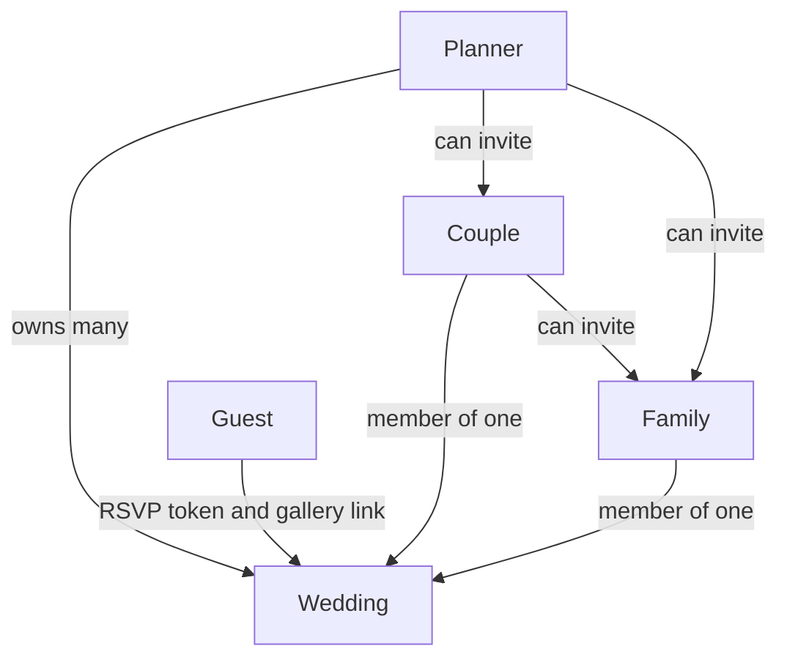

# Make My Marriage — Roles and API count

Version 1. This closes the planning set. Behavior is in [make-my-marriage.md](make-my-marriage.md). Each call is specified in [api-design.md](api-design.md).

## Roles

There are **4 roles**.

| Role    | How they get in                                   | Scope                                   |
| ------- | ------------------------------------------------- | --------------------------------------- |
| Planner | Signs up                                          | Owns many weddings. This is the tenant. |
| Couple  | Invite from the planner or the other couple login | One wedding                             |
| Family  | Invite from the planner or the couple             | One wedding                             |
| Guest   | No account. Private RSVP link or gallery link     | One household, or the public page       |

The planner is `weddings.ownerId`. Couple and family are rows in `weddingMembers`. A guest is not a user.

One email can be a planner for their own clients and a couple or family member on someone else’s wedding. Those are two different access paths. Owning a wedding never grants access to another planner’s wedding.

## What each role can do

**Planner**

- Create, edit, and delete their weddings.
- Invite and remove couple and family. The planner is the owner, so they do not appear as a member who can be removed.
- Full access to events, run sheet, tasks, vendors, money, guests, the website, YouTube, and photo approval.
- Download the QR code and search Google Places.

**Couple**

- Same wedding access as the planner, including vendors, budget, the website, live settings, and photo approval.
- Can invite family.
- Cannot delete the wedding.
- Cannot remove the planner.

**Family**

- Create and edit tasks and guests.
- Copy a guest’s RSVP link.
- View events, the run sheet, the budget, and approved photos.
- Cannot edit vendors, the website, live settings, or the approval queue.
- Cannot invite anyone.

**Guest**

- Open the published wedding page.
- RSVP for their household, including before the page is published, if they have the token.
- Look up a lost invite by phone on the published page.
- Open the private gallery and upload photos.
- Cannot see other guests, money, the run sheet, or pending photos.

## How many APIs

About **70 operations**.

- **66 Server Actions.** Forms in the app call these. They are not separate URLs. The two added on review are `updateAccount` and `deleteContract`.
- **4 HTTP routes.** The browser calls these directly.

| HTTP route                         | Used for                                              |
| ---------------------------------- | ----------------------------------------------------- |
| `POST /api/uploads/sign`           | Photo, contract, and cover. One route, three purposes |
| `POST /api/uploads/complete`       | Same three purposes, after the file is in R2          |
| `GET /api/weddings/{weddingId}/qr` | PNG of the private gallery URL                        |
| `GET /api/places/search`           | Vendor search                                         |

Counting each upload purpose as its own operation adds 6 calls on those two upload routes (sign and complete, for photo, contract, and cover). 66 actions + 6 upload operations + QR + Places = **74**. The round number to plan against is still **about 70**.

### Server Actions by area

- Auth: 7. Signup, login, logout, update account, request reset, reset password, accept invite.
- Weddings: 6. List, create, get, update, delete, dashboard.
- Events and run sheet: 7. Add, update, and delete an event. Add, update, delete, and reorder run-sheet rows.
- Tasks: 4. List, create, update, delete.
- Vendors: 4. List, create, update, delete.
- Milestones: 4. Add, update, mark paid, mark unpaid.
- Budget lines: 4. List, create, update, delete.
- Expenses: 4. List, create, update, delete.
- Contract download and delete: 2.
- Guests and invite text: 7. List, create, paste, update, delete, preview the WhatsApp message, edit the templates.
- People: 4. List, invite, revoke, remove.
- Website and live: 5. Update the site, change the slug, publish, unpublish, set the YouTube URL.
- Photos: 3. List, approve, reject.
- Public guest calls: 5. Public page, read RSVP, submit RSVP, phone lookup, private gallery.

66 actions. Plus the 4 HTTP routes above.

## Summary

- 4 roles: planner, couple, family, guest.
- The planner owns many weddings. Couple and family join by invite, usually one wedding, and more than one membership is allowed. Guests never log in.
- About 70 API operations: 66 Server Actions and 4 HTTP routes, with the upload routes reused for photos, contracts, and the cover image.
