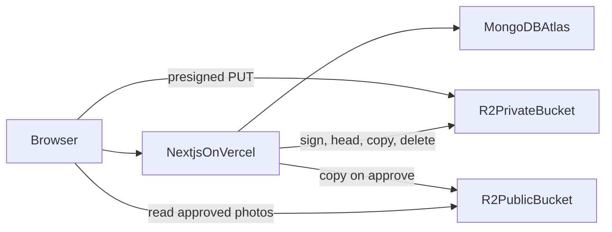
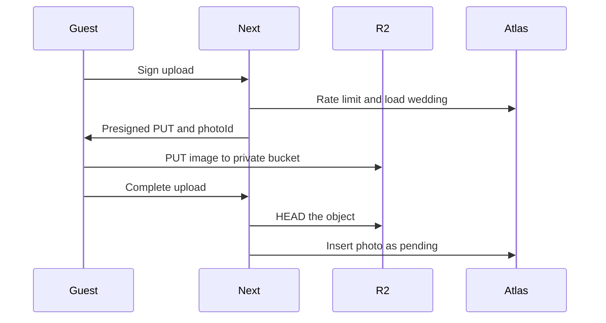

# Make My Marriage — System Design

Version 1 architecture. Product behavior is defined in [make-my-marriage.md](make-my-marriage.md). This document is how that behavior is built.

One Next.js monolith on Vercel. MongoDB Atlas holds the records. Cloudflare R2 holds the files. There is no second API service, no Redis, and no worker process in version one.

## Stack

| Layer            | Choice                                                 | Role                                                                       |
| ---------------- | ------------------------------------------------------ | -------------------------------------------------------------------------- |
| App              | Next.js (App Router) on Node.js                        | One monolith for the planner workspace and the guest page                  |
| Language         | TypeScript                                             | Shared types across UI and server                                          |
| UI               | React Server Components, Tailwind CSS, shadcn/ui       | Planner screens and public wedding pages                                   |
| Mutations        | Server Actions                                         | Form changes inside the app and on the RSVP page                           |
| HTTP endpoints   | Route Handlers                                         | Presigned uploads, the QR image, and Google Places search                  |
| Deployment       | Vercel, region `bom1` (Mumbai)                         | Next.js deploy                                                             |
| Database         | MongoDB Atlas, region `ap-south-1`                     | System of record. Databases `makemymarriage-dev` and `makemymarriage-prod` |
| ODM              | Mongoose                                               | Schemas, indexes, and the milestone payment transaction                    |
| Validation       | Zod                                                    | Every Server Action and Route Handler input                                |
| Auth             | Auth.js, email and password, JWT in an httpOnly cookie | Planner signup. Couple and family join by invite                           |
| Passwords        | bcryptjs                                               | Hashing that runs on Vercel                                                |
| File storage     | Cloudflare R2, buckets `mmm-private` and `mmm-public`  | Photo and contract bytes                                                   |
| Photo metadata   | MongoDB `photos` collection                            | Uploader, approval status, and R2 keys. The image bytes stay in R2         |
| Uploads          | Presigned URL, browser to R2                           | Avoids the Vercel request body limit                                       |
| Email            | Resend                                                 | Member invites and password reset                                          |
| Vendor discovery | Google Places API                                      | Search while adding a vendor. The API key stays on the server              |
| Live stream      | YouTube embed                                          | Planner pastes a YouTube URL. The public page embeds that video            |
| QR               | Generated from the private gallery URL                 | PNG encodes `/g/[galleryToken]`, not the public wedding slug               |
| Access control   | `requireWeddingAccess` in the app                      | Every wedding query checks owner or member                                 |
| Rate limits      | `rateLimits` collection in Atlas                       | Phone lookup and upload signing                                            |
| Guest messages   | `wa.me` links                                          | Opens WhatsApp on the guest’s phone                                        |

## 1. Why this shape

- The product is one web app with two faces: the planner workspace and the guest page. They share types, auth, and wedding rules, so they belong in one deployable.
- Next.js on Node covers both faces. Server Actions handle form changes. Route Handlers exist where the browser needs a non-HTML endpoint: presigned uploads, the QR image, and Google Places search. Zod validates every one of those inputs.
- Atlas is the system of record for weddings, people, money, and RSVPs. A busy wedding is hundreds of households and thousands of photo records, which stays comfortable in separate collections with indexes.
- Image bytes do not belong in the cluster. A 10 MB upload cannot pass through a Vercel request body either (the platform limit is about 4.5 MB). The browser uploads straight to R2. Atlas stores the photo’s status and keys.
- WhatsApp sharing happens in the guest’s own WhatsApp via `wa.me`. Nothing on the server sends those messages, so there is no queue to run.



## 2. Recommendations locked in

- **Mongoose**, not Prisma. Prisma’s MongoDB support is a weak fit for this document model. Mongoose gives a schema per collection and works with the official driver.
- **Auth.js with a JWT session** in an httpOnly cookie. The user record lives in Atlas. A database session would add a read on every request for little gain at this scale.
- **Passwords hashed with bcryptjs**, which runs on Vercel without a native addon.
- **Regions:** Vercel `bom1` (Mumbai) and Atlas `ap-south-1`. Guests and planners are in India.
- **Two Atlas databases**, `makemymarriage-dev` and `makemymarriage-prod`, on the managed cluster. Production data stays out of local development.
- **Two R2 buckets.** `mmm-private` for pending photos and contracts. `mmm-public` for approved gallery photos and the cover image. R2’s public URL is bucket-wide, so a separate public bucket is what keeps pending photos unreachable.
- **Rate limits in Atlas**, a small `rateLimits` collection. An in-memory limiter does not hold across Vercel instances. Redis can wait until abuse shows up.
- **Domain code lives outside the Next.js layer** (`lib/domain`). Routes and actions call it. That keeps the monolith from turning into a pile of page-level queries, and it is the seam if a mobile client ever needs an API.

## 3. Runtime boundaries

Each operation, its caller, and its inputs are in [api-design.md](api-design.md).

- `/weddings` and `/weddings/[weddingId]/*` — planner, couple, or family. Node runtime, session required.
- `/w/[slug]` — guest. Node, public.
- `/w/[slug]/r/[token]` — guest. Node, token.
- `/g/[galleryToken]` — guest. Node, private gallery and upload. The QR code is generated from this URL.
- `POST /api/uploads/sign` and `POST /api/uploads/complete` — guest or member. Node route handlers.
- `GET /api/weddings/[weddingId]/qr` — planner or couple. Node, returns a PNG of the private gallery URL.
- `GET /api/places/search` — planner or couple. Node, Google Places.

Middleware only checks that a session cookie exists on `/weddings`. It does not talk to Atlas. Membership and role are checked in Node, on every server action and route handler, through one function: `requireWeddingAccess(userId, weddingId, capability)`.

Vercel’s edge middleware cannot be the place that loads Mongoose. Forcing the data routes onto the Node runtime is required.

## 4. Access control

Atlas has no row-level security. The application is the enforcement point. Every read and write goes through a wedding-scoped module. A raw `Model.find({})` in a page is a bug.

`getWeddingAccess` resolves:

- `ownerId` matches the user → role `planner`
- else a `weddingMembers` row with `userId` and `inviteStatus: active` → `couple` or `family`
- else no access

Capabilities match the PRD. Planner has every capability. Couple has every capability except `wedding.delete` and `member.removePlanner`. Family has task write, guest write, guest link copy, and read for events, run sheet, budget, and approved photos.

Public handlers do not take a `weddingId` from a hidden form field and trust it. They load the wedding by slug, then the guest by token, and ignore any other id.

Guest tokens are 32 random bytes, base64url. They are stored on the guest so the planner can reopen WhatsApp later. The token is a secret capability URL. It is unique-indexed. It is never written to logs.

## 5. Collections

Field types, indexes, and delete rules are in [database-design.md](database-design.md).

Events and the run sheet are embedded on the wedding. There are only a handful of events, and the public page always loads them with the wedding. Guests, tasks, vendors, money, and photos are their own collections. Those lists are filtered, paged, and updated on their own, and embedding them would push the wedding document toward the 16 MB limit once photos and guests grow.

**users.** `name`, `email` (unique), `passwordHash`, optional `businessName`, timestamps.

**weddings.** `ownerId`, bride and groom names, `title`, `city`, `primaryDate`, `timezone` (`Asia/Kolkata`), `currency` (`INR`), `template`, `slug` (unique), `galleryToken` (unique), `published`, `website` (template id, story, cover public URL), `messages.invite`, `messages.reminder`, `live` (`youtubeUrl`, `visible`), and `events[]`. Each event has name, date, start, optional end, venue, address, map link, dress code, internal notes, `isPublic`, and `runSheet[]` (time, title, owner name, note, order). The private gallery URL is `{APP_URL}/g/{galleryToken}`.

**weddingMembers.** `weddingId`, `userId` (set when accepted), `role` (`couple` or `family`), `name`, `email`, `inviteStatus` (`pending` or `active`), `tokenHash`, `expiresAt`. Unique on `{ weddingId, email }`.

**tasks.** `weddingId`, `title`, `notes`, `status`, `dueDate`, `assigneeId`, `eventId`, `phase`.

**vendors.** `weddingId`, contact fields, `category`, `quote`, `status`, `side`, `notes`, optional `googlePlaceId`, `address`, `mapsUrl`, `contracts[]` (`key`, filename, content type), `milestones[]` (`label`, `amount`, `dueDate`, `status`, `expenseId`).

**budgetLines.** `weddingId`, `category`, `side`, `plannedAmount`, `notes`, optional `vendorId`.

**expenses.** `weddingId`, `amount`, `date`, `side`, `category`, `note`, optional `vendorId`, optional `milestoneId`.

**guests.** `weddingId`, household fields from the PRD, `token`, `invitedEventIds[]`, `rsvps[]` (`eventId`, `status`), `attendingCount`, `responseNote`, `respondedAt`.

**photos.** Metadata only, in MongoDB. `weddingId`, `uploaderName`, `note`, `status` (`pending`, `approved`, `rejected`), `privateKey`, `publicUrl`, `contentType`, `size`, `reviewedAt`, `reviewedBy`. The file itself is in R2.

**rateLimits.** `key`, `count`, `windowStart`. Used for phone lookup and upload signing.

### Indexes

- `weddings`: unique `slug`, unique `galleryToken`, `ownerId` + `primaryDate`
- `weddingMembers`: unique `{ weddingId, email }`, `userId`
- `tasks`: `{ weddingId, status, dueDate }`, `{ weddingId, assigneeId }`
- `vendors`, `budgetLines`, `expenses`: `weddingId`
- `guests`: unique `token`, `{ weddingId, phone }`, `weddingId`
- `photos`: unique `privateKey`, `{ weddingId, status, createdAt }`
- `rateLimits`: unique `key`, TTL on `windowStart` so old windows expire

### The money write

Spent is the sum of `expenses`, grouped by `side`. Marking a milestone paid and creating its expense happens in one Atlas multi-document transaction. Marking it unpaid deletes that linked expense in the same transaction. The cluster is already a replica set, which is what multi-document transactions require. This is the only transaction in version one. Other writes are single-document.

Dashboard counts are four indexed queries (open tasks, guest RSVP totals, expense sums, pending photos). No cached dashboard document until those queries show up as slow in Atlas.

## 6. Photo and contract flow

Signing an upload checks the caller, the MIME type (`image/jpeg`, `image/png`, `image/webp`, or PDF for contracts), and a maximum size of 10 MB. The presigned PUT expires in five minutes and is bound to that content type and length. The object key is `weddings/{weddingId}/photos/{photoId}` or `weddings/{weddingId}/contracts/{fileId}`. The client cannot choose the key.



Complete is idempotent on `privateKey`. If the browser drops after the PUT and before complete, the guest can retry complete. A daily cleanup of private objects with no photo row can wait; it is not in version one.

Approve copies the object into the public bucket, writes `publicUrl`, sets `status: approved`, then deletes the private object. If the copy fails, the photo stays pending. Reject deletes the private object and the photo row.

Contracts stay in the private bucket. Planner and couple download them with a signed GET that expires in a few minutes.

The public gallery reads `publicUrl` only. `next/image` is allowed to load that R2 public host.

The private gallery URL works before the site is published, same as token RSVP. The public homepage still shows approved photos only after publish.

The QR image is generated on the server from that private gallery URL and returned as a PNG the planner can download and print. The code does not point at `/w/[slug]`.

## 7. Auth and invites

- Planner signup and login are email plus password.
- Auth.js credentials provider. JWT strategy. Session cookie, httpOnly, secure in production, about 30 days.
- Couple and family have no public signup. An invite row stores a hashed single-use token and an expiry of 7 days. The inviter sees a copyable link, and Resend sends that same link.
- Accepting an invite creates the user if needed, sets `userId`, and marks the member active.
- Password reset uses the same pattern: a single-use token, copyable link, and a Resend email.

## 8. Public guest paths

- `GET /w/[slug]` loads the wedding by slug. Unpublished weddings render only the unpublished message. Published pages render from the wedding document plus approved photos. No guest phone numbers in the payload.
- RSVP reads and updates one guest by `token`, and only events in `invitedEventIds`. Attending count cannot exceed `partySize`.
- Phone lookup finds guests in that wedding whose phone matches. One match redirects to the token path. Zero or many matches show the same “use your WhatsApp link” message. The limiter key is slug plus IP, fixed window, stored in `rateLimits`.
- A YouTube URL is checked with Zod, then converted to an embed URL on the server (`youtube.com/watch`, `youtu.be`, or `youtube.com/live`). Any other URL is rejected. The live block renders only when `live.visible` is true and the URL is present.
- Vendor search calls the Google Places API from a Route Handler. The browser sends the query. The server returns place id, name, address, and phone, and stores `googlePlaceId` on the vendor. `GOOGLE_PLACES_API_KEY` is never sent to the client.

## 9. App layout

```
app/
  (auth)/login, signup, invite/[token]
  (workspace)/weddings, weddings/[weddingId]/...
  w/[slug]/page, r/[token]
  g/[galleryToken]              private gallery and upload
  api/uploads/sign, api/uploads/complete
  api/weddings/[weddingId]/qr   QR png of the private gallery URL
  api/places/search             Google Places, session required
lib/
  db.ts            cached Mongoose connection
  auth.ts          Auth.js
  r2.ts            presign, head, copy, delete
  email.ts         Resend
  places.ts        Google Places
  validation/      Zod schemas
  access.ts        requireWeddingAccess
  domain/          weddings, tasks, vendors, budget, guests, photos
  models/          Mongoose schemas
```

`lib/db.ts` caches the connection on `globalThis` so warm Vercel instances reuse it. Pool size stays small (10) so many instances do not exhaust Atlas connections. The driver uses TLS and `retryWrites`.

Atlas network access for Vercel is TLS from the internet, because serverless egress has no stable IP. The database user can read and write only this application’s databases. The password lives in Vercel env, not in the repo.

Environment: `MONGODB_URI`, `MONGODB_DB`, `AUTH_SECRET`, `R2_ACCOUNT_ID`, `R2_ACCESS_KEY_ID`, `R2_SECRET_ACCESS_KEY`, `R2_PRIVATE_BUCKET`, `R2_PUBLIC_BUCKET`, `R2_PUBLIC_BASE_URL`, `NEXT_PUBLIC_APP_URL`, `RESEND_API_KEY`, `EMAIL_FROM`, `GOOGLE_PLACES_API_KEY`.

## 10. What we are not adding

A separate Express API, Redis, a job queue, Atlas Search, image-processing workers, and storing binaries in GridFS. Wedding traffic is people clicking, not a firehose. Indexes, presigned uploads, and the Mumbai region cover version one. If pending-photo cleanup or thumbnail generation becomes real work, that is the first reason to add a small scheduled job, still inside this repo, still not a new service.

## Summary

This document covers how version one is built:

- The stack: Next.js monolith, Vercel, MongoDB Atlas, Mongoose, Zod, Auth.js, Cloudflare R2, Resend, Google Places, and YouTube embed.
- Why the app is one deployable, with presigned uploads and no queue.
- Routes, the Node runtime, and session checks.
- Multi-tenant access: one shared database, a planner as the tenant through `ownerId`, and each wedding isolated by `weddingId`.
- Collections, indexes, and the single money transaction.
- Photo and contract flow, auth and Resend invites, public guest paths, app layout, environment variables, and what stays out of version one.
